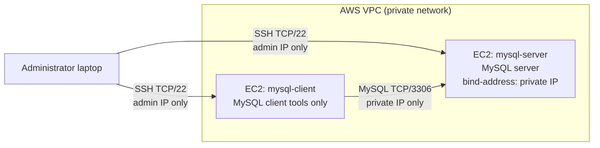
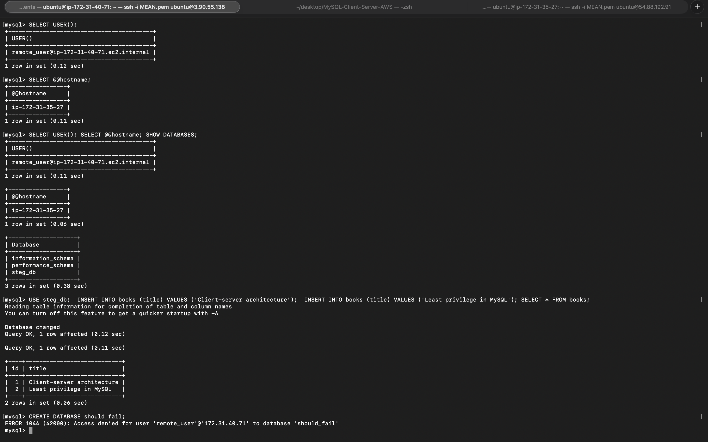
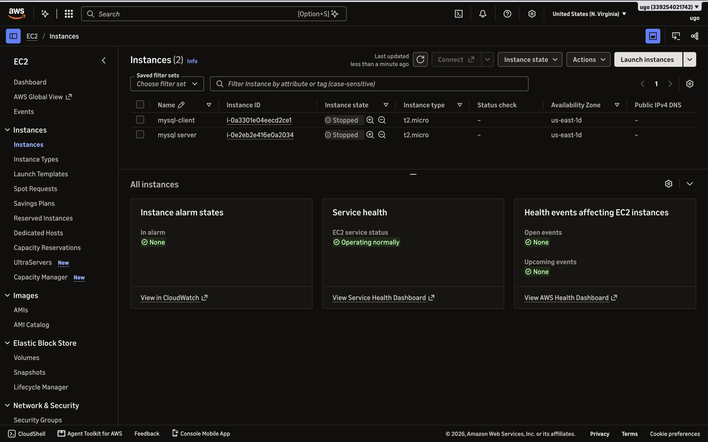
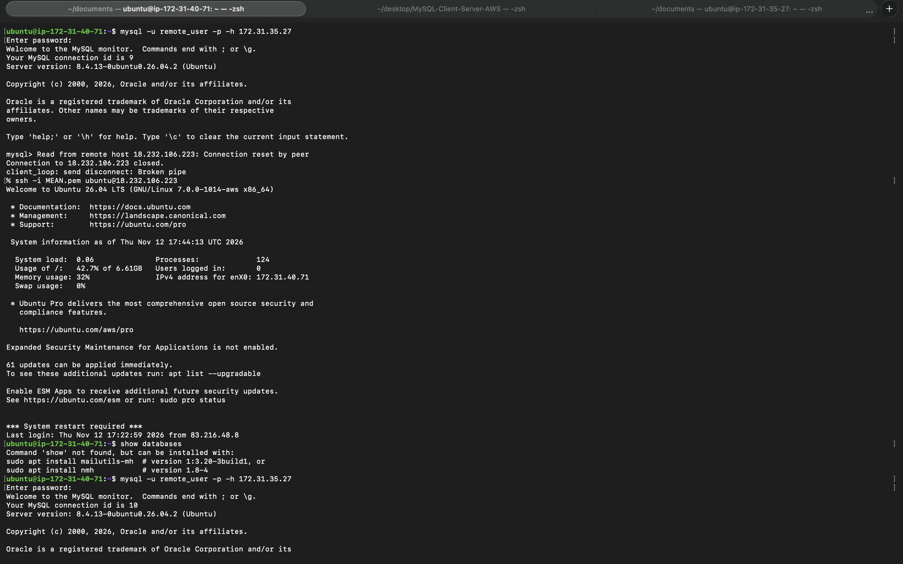

# MySQL Client-Server Architecture on AWS

## Project Overview
Two Ubuntu EC2 instances in the same VPC: one runs the MySQL server,
the other runs only the MySQL client tools. The client connects to the
server over the private network. Completed as part of the Steghub
Cloud Engineering internship.


## Architecture



## Access Control Layers
1. `bind-address` in mysqld.cnf — is MySQL listening on the network interface?
2. Security group — is the client allowed to reach port 3306?
3. MySQL user host — is this user allowed to connect from the client's IP?

## Step 1 — Launch Instances
- `mysql-server` and `mysql-client`, Ubuntu 22.04, t2.micro
- Same VPC, shared key pair 
- Security groups: SSH from My IP on both; port 3306 on the server
  restricted to the client's private IP /32

## Step 2 — Install MySQL Server (mysql-server)
```bash
sudo apt update
sudo apt install mysql-server -y
sudo systemctl enable --now mysql
```

## Step 3 — Install MySQL Client (mysql-client)
```bash
sudo apt update
sudo apt install mysql-client -y
```

## Step 4 — Allow Remote Connections
Edit `/etc/mysql/mysql.conf.d/mysqld.cnf`:
```
bind-address = 0.0.0.0
```
Then restart and verify:
```bash
sudo systemctl restart mysql
sudo ss -tlnp | grep 3306
```

## Step 5 — Create Remote User (on server)
```sql
CREATE USER 'remote_user'@'<client-private-ip>' IDENTIFIED BY '<password>';
GRANT ALL PRIVILEGES ON *.* TO 'remote_user'@'<client-private-ip>';
FLUSH PRIVILEGES;
```

## Step 6 — Connect From Client
```bash
mysql -u remote_user -p -h <server-private-ip>
```

## Least Privilege

`remote_user` was initially granted `ALL PRIVILEGES ON *.*`, which gave
far more access than the project needed. I created a dedicated database,
`steg_db`, and limited the user to `SELECT, INSERT, UPDATE, DELETE`
on that database only. The user remains restricted to the client's
private IP rather than `%`.

MySQL now binds to the server's private IP instead of `0.0.0.0`, so it
only listens on the VPC-facing interface.

## Final Verification

From the client instance, connected to the server's private IP:

| Command | Result |
|---|---|
| `SELECT USER();` | `remote_user@<client-private-ip>` |
| `SELECT @@hostname;` | Returned the server's hostname, proving the query ran remotely |
| `SHOW DATABASES;` | Only `project_db` and system schemas visible |
| `INSERT` / `SELECT` on `project_db.books` | Rows inserted and returned successfully |
| `CREATE DATABASE should_fail;` | `ERROR 1044 Access denied`, confirming restricted privileges |




## Security Notes
- Port 3306 accepts connections only from the client's private IP
- SSH on both instances is restricted to a trusted administrator IP
- No passwords, AWS credentials or private keys are committed

## Errors Encountered and Fixed

### Error 2003 — Can't connect to MySQL server
**Cause:** MySQL bound to 127.0.0.1, so it ignored traffic from the network.
**Fix:** Set `bind-address = 0.0.0.0`, restarted MySQL, and confirmed
port 3306 was listening with `ss -tlnp`.

## Key Learnings
- Clients and servers are separate machines communicating over a network
- Private IPs keep database traffic inside the VPC
- Three layers must all allow a connection: service config, firewall, and database user permissions
- Restricting the security group to a specific client IP follows least privilege

## Screenshots


